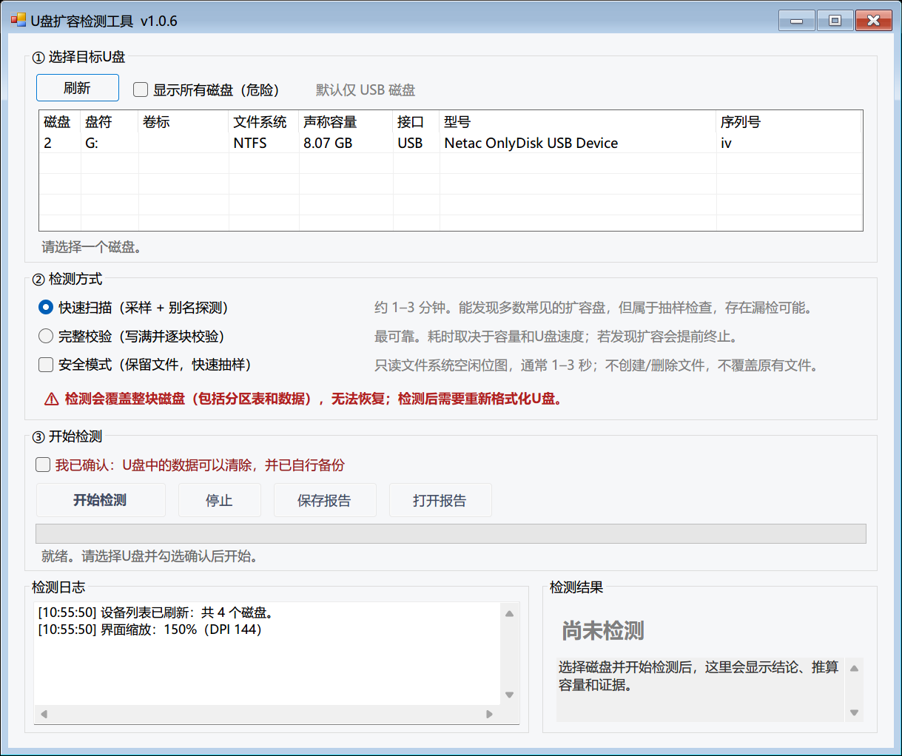

# U盘扩容检测工具

一个用于检测 **“扩容盘”（虚标容量的 U 盘 / 存储卡 / 移动硬盘）** 的 Windows 小工具。

图形界面、单文件 EXE、无需安装、无需 Python/.NET SDK（使用 Windows 自带的 .NET Framework 4.x）。



---

## 它能做什么

- 自动列出 USB 接口的磁盘（U 盘、读卡器、移动硬盘），显示盘符、卷标、文件系统、标称容量、型号和序列号。
- **快速扫描**：约 1–3 分钟。向整盘均匀写入上百个带唯一标记的数据块，读回校验，并针对常见“真实容量”做别名探测，可发现多数常见的扩容盘。
- **完整校验**：先做 64 点快速预扫描（含别名探测），正常盘继续写满标称容量并逐块读回比对，最可靠；一旦发现扩容会立即终止并给出实际容量。
- **安全模式（保留文件）**：读取文件系统空闲簇位图，只向标记为空闲的区域写入约 0.5 MB 测试标记，通常几秒内给出实际容量；不创建/删除文件，正常盘上原有文件不受影响。
- **提前终止**：完整校验每写入一块就校验末端数据；一旦发现写入被丢弃（扩容盘常见行为），立即在真实容量附近停止，不会傻写 268 GB。
- **显示实际容量**：快速扫描会用二分法定位“还能正常写入”的边界，完整校验则在提前终止时给出实际可用容量。
- 给出首个异常位置和检测证据，并自动生成中文检测报告。
- 保护措施：默认只列出 USB 磁盘；禁止检测系统盘；检测非 USB 磁盘需要额外勾选确认。

## 重要警告（务必阅读）

> **检测会直接读写整块磁盘，覆盖分区表和全部数据，且无法恢复。**
>
> - 检测前请先备份 U 盘中的文件；
> - 检测完成后 U 盘会变成“未格式化/Raw”状态，**必须重新格式化**才能继续使用；
> - 请不要对系统盘、含有唯一数据且未备份的磁盘使用本工具；
> - 扩容盘上的原有数据可能早已损坏，检测只是把问题暴露出来。
>
> 如果不想清空 U 盘，请勾选 **“安全模式（保留文件）”**：只写空闲簇、几秒完成，不主动修改原有文件。注意：回绕型扩容盘可能无法识别，且扩容盘仍可能损坏数据。
> 但如果是扩容盘，写入仍可能覆盖原有文件或破坏文件系统，重要数据请先备份。

## 使用方法

1. 双击 `启动检测工具.cmd`，或直接运行 `bin\UsbFakeDriveDetector.exe`。
   程序会请求管理员权限（直接访问磁盘扇区、卸载卷需要管理员权限），请在 UAC 提示中选择“是”。
2. 插入 U 盘，点击 **刷新设备**。
3. 在列表中选中要检测的 U 盘，核对磁盘编号、盘符、容量和型号。
4. 勾选 **“我已确认：U盘中的数据可以清除，并已自行备份”**。
5. 选择检测方式：
   - **快速扫描**：抽样 + 别名探测，约 1–3 分钟，适合先快速判断（会写入全盘，破坏性）；
   - **完整校验**：写满并逐块校验，最可靠，耗时取决于容量和 U 盘速度（按 12–80 MB/s 估算，例如 32 GB 约 13 分钟–1.5 小时）。
   - 如果要保留原有文件，勾选工具栏上的 **“安全模式（保留文件）”**：读取空闲簇位图并抽样，通常 1–3 秒完成；测试期间该卷会临时卸载，结束后自动恢复。


6. 点击 **开始检测**，等待完成。检测过程中请勿拔出 U 盘。
7. 查看右侧结论和下方的检测证据；报告会自动保存到：
   `文档\U盘容量检测报告\U盘检测_yyyyMMdd_HHmmss.txt`

### 预览界面（不写磁盘）

不插入 U 盘、也不需要管理员权限，可以直接查看演示效果：

```bat
bin\UsbFakeDriveDetector.exe --demo
```

程序会用内存中的模拟设备跑一遍“标称 64 MB / 实际 8 MB”的扩容盘检测并展示结果（上方截图即为演示结果），不会触碰任何真实磁盘。

## 结果说明

| 结论 | 含义 | 建议 |
| --- | --- | --- |
| ✔ 正常：未发现扩容迹象 | 本次检测没有发现地址回绕或丢写 | 快速扫描仍属抽样，重要场合请做完整校验 |
| ✘ 疑似扩容盘 | 发现地址回绕，或高地址数据覆盖低地址 | 不要存放重要数据，尽快联系商家退货 |
| ⚠ 设备异常：数据无法正确读回 | 数据在某个位置之后失效，可能是扩容盘，也可能是闪存/主控故障 | 换一块 U 盘复测 |
| 检测失败 / 已取消 | 权限、占用、写保护、拔出等原因导致未完成 | 按提示处理后重试 |

## 检测原理

1. **带身份的数据块**
   每个 4 KB 测试块都包含本次运行随机生成的 ID、它本应写入的逻辑偏移，以及校验和。因此数据一旦“跑”到别的偏移，就能被识别出来。

2. **快速扫描（采样）**
   在整盘范围内均匀取上百个采样点，各写入一个唯一标记，然后重新打开设备读回：
   - 校验失败或读回全 0 → 该位置不可靠（丢写/坏块）；随后在“最后一个正常点”和“第一个异常点”之间二分写入探测标记，定位实际可写容量；
   - 读回的标记属于**另一个偏移** → 地址发生了回绕（扩容盘的典型行为）；
   - 另外做**别名探测**：向常见的“真实容量”位置（如 4/8/16/32/64 GB 及标称容量的若干分数）写入标记，再检查偏移 0 是否被覆盖。如果某个位置写入后偏移 0 变成了该标记，说明设备在这个位置回绕到了起点，从而推算真实容量。

3. **完整校验**
   顺序写满整盘（每个 4 KB 块带偏移头），写入过程中每约 1 GB 检查一次最前面的 8 MB：
   - 如果起始区域出现“本应写在后面的数据” → 已发生回绕，立即停止并估算容量；
   - 写满后再从头逐块读回比对，任何一块不一致都会被记录并分析。
   另外，每写入一个 4 MB 数据块，都会立刻读回该块最后一个 4 KB 块进行比对：如果“刚写完就读不回来”，说明超出真实容量的写入被丢弃，工具会立即在真实容量附近终止，并二分定位到 32 KB 精度。这样即使假盘不会“回绕”、只是丢写，也不会写满 268 GB 才发现。

4. **容量估算**
   回绕时，同一份数据会出现在 `偏移 + k × 真实容量` 的位置。工具收集多组“本应写入 X、实际出现在 Y”的证据，对差值取最大公约数，并用不同位置的多组探测值校正，得到真实容量的近似值。由于部分假盘的主控映射不规律，估算值会标注为“约/估算”。

5. **安全模式（保留文件）**
   通过 `FSCTL_GET_VOLUME_BITMAP`（exFAT 则解析其分配位图）取得空闲簇，并锁定、卸载卷；在这些空闲簇上均匀抽查约 128 个 4 KB 标记，写回校验并二分定位容量边界。整个过程只写约 0.5 MB 空闲区数据，不创建/删除文件，通常 1–3 秒完成。局限：它不会写 0 号扇区，回绕型假盘可能识别不出来；这类盘请用“快速扫描”。

6. **绕过系统缓存**
   通过 `CreateFile` + `FILE_FLAG_NO_BUFFERING` + `FILE_FLAG_WRITE_THROUGH` 直接读写扇区/文件，并在整盘模式下锁定、卸载卷，避免 Windows 文件缓存返回“看起来正确”的假数据。

## 常见问题

**Q：提示“无法打开物理磁盘：拒绝访问/共享冲突”？**
关闭可能占用 U 盘的资源管理器窗口、杀毒软件扫描、下载/同步软件，或拔插一次 U 盘后重试。仍不行可重启电脑再试。

**Q：提示“卷 E: 锁定失败/卸载失败”？**
说明有程序正在使用该卷。工具仍会尝试写入，但建议先关闭占用程序。必要时在“磁盘管理”中先脱机该磁盘。

**Q：提示“无法获取磁盘容量：函数不正确”？**
v1.0.1 已修复。部分 USB 主控不支持对物理磁盘调用 `GetFileSizeEx`，现在会依次尝试
`IOCTL_DISK_GET_LENGTH_INFO`、`GetFileSizeEx`、`IOCTL_DISK_GET_DRIVE_GEOMETRY_EX`，
最后退回系统报告的容量，因此这类主控也能正常检测。

**Q：我不想清空 U 盘，可以检测吗？**
可以，勾选 **“安全模式（保留文件）”**。程序读取卷的空闲簇位图，只向空闲区写约 0.5 MB 测试标记，通常几秒完成；不创建/删除文件。测试时该卷会临时卸载，结束后自动恢复。注意：回绕型扩容盘可能识别不了，建议先用“快速扫描”判断。

**Q：安全模式能给出实际容量吗？**
能。安全模式在空闲簇上抽样并二分定位，通常可给出实际可用容量（例如标称 268 GB 的假盘实测约 8.3 GB）。但空闲簇的物理位置不连续，结果比整盘模式略粗；回绕型假盘可能无法识别。

**Q：安全模式提示“无法锁定卷”？**
说明有程序正在使用该 U 盘（复制文件、杀毒扫描等）。关闭占用程序后重试；锁定卷是为了保证读到的空闲位图与磁盘一致。

**Q：检测时间很长？**
完整校验需要写入 + 读回两倍数据量。32 GB 的 U 盘在 20 MB/s 下约 50 分钟；速度快慢取决于 U 盘本身。扩容盘会在真实容量处提前结束。

**Q：快速扫描显示正常，还需要完整校验吗？**
建议做。快速扫描是抽样检查，如果假盘的真实容量非常接近标称容量，或主控的地址映射不规律，可能漏检。完整校验是逐块写读比对，结论可靠得多。

**Q：检测后 U 盘打不开 / 提示格式化？**
正常现象：检测数据覆盖了分区表。请在“此电脑”中右键 U 盘 → 格式化，或使用磁盘管理重新分区。

**Q：能检测存储卡、移动硬盘吗？**
可以，只要是 USB 接口的块设备。内置硬盘默认不显示；如确需检测，勾选“显示所有磁盘”后再勾选额外确认，系统盘会被禁止。

**Q：为什么必须用管理员权限？**
需要打开 `\\.\PhysicalDriveN` 并发送 `FSCTL_LOCK_VOLUME` / `FSCTL_DISMOUNT_VOLUME` 卸载卷，普通权限无法完成。

**Q：检测会损坏 U 盘吗？**
正常盘只是被写入测试数据（检测后格式化即可）。扩容盘本身已经不可靠，检测会让它暴露问题；若闪存本身有坏块，也可能在写入时出错（工具会报告“设备异常”）。

## 算法自检（不需要 U 盘）

```bat
bin\selftest.exe reports\selftest.txt
```

自检使用内存模拟设备（正常盘、地址回绕型扩容盘、丢写型扩容盘），验证标记格式、判定逻辑和容量估算，不访问任何真实磁盘。全部通过时退出码为 0。

## 从源码编译

只需 Windows 自带的 .NET Framework 4.x（Windows 10/11 默认包含）：

```powershell
powershell -NoProfile -ExecutionPolicy Bypass -File .\build.ps1
```

生成：

- `bin\UsbFakeDriveDetector.exe` —— 图形界面（WinForms）
- `bin\selftest.exe` —— 控制台算法自检

## 目录结构

```
.
├─ bin\                       编译产物（exe）
├─ docs\screenshot.png        界面截图
├─ src\                       源码（C# 5 / .NET Framework 4.x）
│  ├─ Program.cs              入口、管理员权限提升
│  ├─ MainForm.cs             WinForms 界面
│  ├─ Detector.cs             检测引擎（快速扫描 / 完整校验 / 容量估算）
│  ├─ Devices.cs              物理磁盘读写、卷锁定/卸载
│  ├─ SafeVolumeScanner.cs    安全模式：空闲簇位图抽样、卷锁定/卸载
│  ├─ ExFatBitmap.cs          exFAT 空闲位图解析
│  ├─ FileTestSet.cs          旧文件模式（--file 兼容）
│  ├─ Native.cs               Win32 P/Invoke、对齐缓冲区
│  ├─ Patterns.cs             测试数据格式、校验和
│  ├─ DiskInventory.cs        WMI 磁盘/卷枚举
│  ├─ SimDisk.cs              自检用模拟设备
│  ├─ SelfTest.cs             自检用例
│  ├─ SelfTestMain.cs         自检程序入口
│  ├─ Report.cs               检测报告生成
│  ├─ Diagnostics.cs          只读诊断 / 命令行检测
│  ├─ AssemblyInfo.cs         程序集信息
│  └─ Util.cs                 格式化工具
├─ build.ps1                  编译脚本
├─ 启动检测工具.cmd            双击启动
└─ README.md
```

## 故障诊断（命令行）

不写入数据、只读检查某块磁盘能否打开以及容量查询方式（结果输出到文件）：

```bat
bin\UsbFakeDriveDetector.exe --probe 2 reports\probe.txt
```

命令行执行一次**真实检测**（会写入磁盘，请确认磁盘编号）：

```bat
bin\UsbFakeDriveDetector.exe --run 2 quick reports\disk2.txt
bin\UsbFakeDriveDetector.exe --run 2 full  reports\disk2.txt
```

`--run` 的退出码：0 = 正常，3 = 疑似扩容盘/设备异常，1 = 执行出错。报告和运行日志会写入指定文件及 `.log`。

安全模式（保留文件，只写空闲簇，几秒完成）：

```bat
bin\UsbFakeDriveDetector.exe --safe G: reports\safe-g.txt
```

退出码同上。

> `--file` 是旧的文件模式（写满可用空间，较慢），仅保留兼容，建议改用 `--safe`。

## 更新记录

- **v1.0.6**：界面改版——默认宽度收窄到 820px（150% 缩放约 1230px），磁盘列表列宽随窗口自适应，日志/结果区按比例伸缩；安全模式移到“检测方式”区域；自动隐藏无介质设备。
- **v1.0.5**：修复安全模式在 exFAT 卷上的簇偏移错误（可能写坏已有文件）以及位图未落盘问题；安全模式改为逐点写入校验、发现异常立即停止，尽量少写假盘的原有数据区域。
- **v1.0.4**：安全模式改为“读取文件系统空闲簇位图 + 只写空闲区抽样”（支持 NTFS/FAT/exFAT），几秒内识别扩容盘并给出实际容量，不再写满可用空间；修复安全模式慢、难以识别假盘的问题；新增 `--safe` 命令行。
- **v1.0.3**：完整校验先做 64 点快速预扫描（含别名探测），扩容盘几秒内结束并显示实际容量；写入过程增加末端块校验，丢写型假盘在实际容量附近提前终止；快速扫描用二分法显示实际容量；修复高 DPI 下界面模糊（按 DPI 等比缩放控件）。
- **v1.0.2**：新增**安全模式（文件模式）**，只在可用空间创建临时测试文件、检测后自动删除，不覆盖原有文件；新增文件模式命令行接口 `--file`。
- **v1.0.1**：修复部分 USB 主控不支持 `GetFileSizeEx` 导致“无法获取磁盘容量：函数不正确”的问题；容量查询增加多种回退方式；新增只读诊断模式与命令行检测模式。
- **v1.0.0**：初始版本。

## 限制与说明

- 仅支持 Windows（直接使用 Win32 磁盘 API）。
- 快速扫描是抽样检测，**不能保证 100% 识别所有扩容盘**；重要数据请以完整校验为准。
- 极少数假盘会用主控 RAM 缓存伪装“读回成功”。检测完成后拔插 U 盘再复测一次可以识破。
- 本工具检测的是**容量是否虚标**，不包含闪存寿命、坏块全盘扫描、读写性能测试。
- 检测结果仅供参考，不构成对商品质量的鉴定结论。

## 免责声明

本软件会不可逆地覆盖目标磁盘数据。使用前请自行确认目标磁盘并备份数据；因误选磁盘、数据丢失等造成的损失由使用者自行承担。


